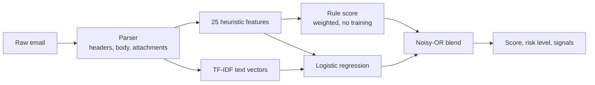

# 🛡️ Email Fraud Detection

[](https://github.com/amujacic2/Email-Fraud-Detection/actions/workflows/ci.yml)


**Explainable phishing and email-fraud detection.** Paste or pipe in an email and get a fraud score, a risk level, and the exact signals that fired, from a CLI, a REST API, or a built-in web UI.

```text
$ emailfraud scan samples/phishing.eml samples/legit.eml
samples/phishing.eml: FRAUD [high risk] score 1.00 | signals: has_ip_url, urgency_hits, credential_hits, ...
samples/legit.eml: LEGITIMATE [low risk] score 0.01 | signals: none
```

## Why it's different

Most spam filters are black boxes. This one tells you **why** an email looks fraudulent, and it keeps working on obvious attacks even if the ML model has never seen similar wording, because a transparent rule engine backs it up.

## How it works



`final = 1 - (1 - ml_probability) × (1 - rule_score)` — either component can raise the alarm.

## Detection signals

| Signal | What it catches |
|---|---|
| `has_ip_url` | Links to raw IP addresses |
| `lookalike_domain` | Typosquats and leetspeak such as `paypa1.com`, `paypal-secure.xyz` |
| `display_name_spoof` | `"PayPal Support" <help@random-host.net>` |
| `auth_failures` | SPF / DKIM / DMARC `fail`, `softfail`, `none` in `Authentication-Results` |
| `reply_to_mismatch` | `Reply-To` domain differs from `From` |
| `link_text_mismatch` | HTML link that shows `www.bank.com` but points elsewhere |
| `has_punycode` | `xn--` homograph domains |
| `risky_attachment` | `.exe`, `.scr`, `.js`, `.docm`, `invoice.pdf.exe`, ... |
| `has_shortener` / `has_suspicious_tld` / `has_at_in_url` | Obfuscated or low-trust URLs |
| `html_form` | Credential-harvesting forms inside the email |
| `urgency_hits` / `money_hits` / `credential_hits` | Pressure, payment, and password language |
| `exclaim_count` | Shouty punctuation |
| `pii_request` | Asks you to send SSN, date of birth, card number, bank details, passwords |
| `scam_phrases` | Prize/lottery, advance-fee, inheritance, tax refund, work-from-home, crypto doubling, locked-account and delivery-fee wording |
| `bec_pattern` | Boss/CEO impersonation: "are you at your desk?", "quick task", "reply as soon as you see this" |
| `generic_greeting` / `secrecy` / `click_cta` / `large_amount` | "Dear friend", "do not tell anyone", "click here", multi-million sums |

## Quick start

```bash
git clone https://github.com/amujacic2/Email-Fraud-Detection.git
cd Email-Fraud-Detection
python -m venv .venv
source .venv/bin/activate          # Windows: .venv\Scripts\activate
pip install -e ".[dev]"

python scripts/generate_data.py    # builds data/emails.csv (synthetic)
emailfraud train                   # saves models/model.joblib
emailfraud scan samples/phishing.eml
```

### Web UI and REST API

```bash
uvicorn emailfraud.api:app --reload
```

Open <http://127.0.0.1:8000> for the UI, or <http://127.0.0.1:8000/docs> for interactive API docs.

```bash
curl -X POST http://127.0.0.1:8000/scan \
  -H "Content-Type: application/json" \
  -d '{"raw": "From: x@evil.xyz\nSubject: URGENT\n\nVerify your account http://10.0.0.1/login"}'
```

```json
{"score": 0.93, "label": "fraud", "risk": "high",
 "signals": ["has_ip_url", "urgency_hits", "credential_hits"],
 "ml_score": 0.41, "rule_score": 0.88}
```

### Docker

```bash
docker build -t email-fraud-detection .
docker run --rm -p 8000:8000 email-fraud-detection
```

### CLI reference

| Command | Purpose |
|---|---|
| `emailfraud train [--data CSV] [--out PATH]` | Train and save a model |
| `emailfraud evaluate [--data CSV] [--folds 5]` | Stratified k-fold precision / recall / F1 / ROC-AUC |
| `emailfraud scan FILE... [--json]` | Score `.eml` / `.txt` files (`-` reads stdin). Exit code 1 if anything is flagged, handy in scripts and mail pipelines |

## Development

```bash
make install   # pip install -e ".[dev]"
make test      # pytest
make lint      # ruff check + format check
make serve     # train + run the API with reload
```

CI runs lint, the test suite on Python 3.11 / 3.12 / 3.13, cross-validation, and a Docker build. See [CONTRIBUTING.md](CONTRIBUTING.md) to add a new detection signal.

## ⚠️ Honest limitations

- The bundled dataset is **synthetic and template-based**. Cross-validation scores on it are near-perfect because the model can memorise the templates, so **they say nothing about real-world accuracy**. The tests include handwritten emails outside the templates to check that the hybrid scoring generalises, but that is a smoke test, not a benchmark.
- For real use, train on a genuine corpus (for example Enron for legitimate mail and the Nazario phishing corpus for fraud) in the same `text,label` CSV format (`label` 1 = fraud), then re-run `emailfraud evaluate`.
- Heuristics can be evaded and legitimate mail can trip them. Treat the output as a triage aid, not a verdict. See [SECURITY.md](SECURITY.md).

## Project layout

```
src/emailfraud/   features.py (signals + rule score), model.py (hybrid model), api.py, cli.py, static/ (web UI)
scripts/          synthetic data generator
samples/          example emails to try
tests/            pytest suite (features, model, API)
.github/          CI, Dependabot, issue and PR templates
```

## Roadmap

- [ ] Real-corpus benchmark and published metrics
- [ ] URL reputation lookups (opt-in)
- [ ] `.msg` / `.mbox` ingestion
- [ ] Gradient-boosted model option and calibration

## License

MIT © Amar Mujacic
